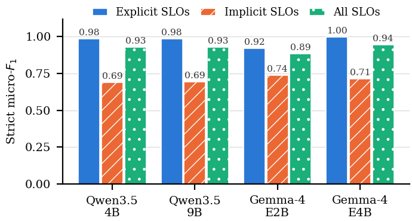

# RQ1: Translation performance

**Question.** How accurately do lightweight open models (at most 10B parameters) translate a valid operator intent into the ground-truth SLOs, depending on model family, size and prompting setup?

**Setup in one paragraph.** Ten models from five families (Qwen3.5, Gemma 4, Ministral 3, Granite 4.1, Llama 3), two sizes each, are run with four prompting setups on the 521 valid intents of the dataset (greedy decoding, one run per configuration, native thinking off). The scorer counts an SLO as correct only if type, metric, comparator, qualifier, value and unit all equal a ground-truth SLO ("strict" micro-F1). EM is the share of intents whose SLO set is exactly right. Gemma 4 sizes are effective parameters.

| Name in the code and result files | Name in the paper |
|---|---|
| `zs3` | `zs` |
| `fs3` | `fs` |
| `zs3_cot` (`zs3 CoT` in some CSVs) | `zs-cot` |
| `fs3_cot` (`fs3 CoT`) | `fs-cot` |

## Table II: strict F1 and exact match (521 valid intents)

| Model | zs F1 | zs EM | fs F1 | fs EM | zs-cot F1 | zs-cot EM | fs-cot F1 | fs-cot EM | Mean F1 |
|---|---:|---:|---:|---:|---:|---:|---:|---:|---:|
| Qwen3.5-4B | 0.918 | 0.820 | 0.910 | 0.774 | 0.892 | 0.772 | 0.929 | 0.845 | 0.912 |
| Qwen3.5-9B | 0.921 | 0.835 | 0.922 | 0.802 | 0.942 | 0.879 | 0.930 | 0.823 | 0.929 |
| Gemma-4-E2B | 0.591 | 0.397 | 0.602 | 0.399 | 0.850 | 0.695 | 0.886 | 0.747 | 0.732 |
| Gemma-4-E4B | 0.726 | 0.403 | 0.872 | 0.733 | 0.883 | 0.754 | 0.943 | 0.879 | 0.856 |
| Ministral-3-3B | 0.408 | 0.159 | 0.714 | 0.493 | 0.479 | 0.236 | 0.847 | 0.702 | 0.612 |
| Ministral-3-8B | 0.889 | 0.779 | 0.917 | 0.795 | 0.896 | 0.779 | 0.920 | 0.825 | 0.905 |
| Granite-4.1-3B | 0.248 | 0.188 | 0.651 | 0.359 | 0.269 | 0.150 | 0.522 | 0.253 | 0.423 |
| Granite-4.1-8B | 0.764 | 0.587 | 0.855 | 0.672 | 0.776 | 0.601 | 0.867 | 0.716 | 0.816 |
| Llama-3.2-3B | 0.114 | 0.035 | 0.440 | 0.167 | 0.101 | 0.006 | 0.470 | 0.140 | 0.281 |
| Llama-3.1-8B | 0.448 | 0.286 | 0.749 | 0.507 | 0.433 | 0.200 | 0.756 | 0.501 | 0.597 |

Source: `results/tab2_rq1.csv` (also `tab2_rq1.tex`, the LaTeX table of the paper), built from `results/V-01_f1_real_synthetic_total.csv` and `results/V-03_em_and_jaccard.csv`.

## Figure 2: explicit versus implicit SLOs



Strict F1 of the two best families with `fs-cot` on explicit SLOs (thresholds stated in the intent), implicit SLOs (values that must be read from the telemetry snapshot, e.g. "the lowest memory utilization") and all SLOs. Data: `results/V-08_f1_explicit_implicit.csv` (all ten models and four setups) and `results/V-08_counts.csv` (number of SLOs of each kind).

## Key findings (as stated in the paper)
- F1 ranges from 0.101 (Llama-3.2-3B, `zs-cot`) to 0.943 (Gemma-4-E4B, `fs-cot`); the best exact-match rate is 0.879 (Qwen3.5-9B `zs-cot` and Gemma-4-E4B `fs-cot`).
- Two configurations (Qwen3.5-9B `zs-cot`, 0.942, and Gemma-4-E4B `fs-cot`, 0.943) reach the F1 of 0.941 that the Intent Engine paper reports for its full pipeline with GPT-4.1 mini (see the citation below; different prompts and model, so this is a direction, not a like-for-like comparison).
- Model family matters as much as size. The mean F1 is highest for Qwen3.5-9B (0.929) and Qwen3.5-4B (0.912); the 4B Qwen model has a higher mean than the 8B model of every other family. The gain of the larger model of a family ranges from 0.016 (Qwen3.5) to 0.393 (Granite 4.1) in mean F1 (`results/V-06_large_minus_small.csv`; computed before rounding).
- `fs-cot` gives the highest F1 for 8 of the 10 models and the second highest for the other two. The gain is largest for the models that are weak in `zs`: Ministral-3-3B rises from 0.408 to 0.847 and Gemma-4-E2B from 0.591 to 0.886.
- With `fs-cot`, the four Qwen and Gemma models reach an F1 of 0.919 to 0.997 on explicit SLOs but only 0.688 to 0.739 on implicit ones.

## Reproduce
**Tier A (no GPU, no model; works now).** From the repository root:
```bash
pip install -r requirements-analysis.txt
python rq1_performance/make_table_and_figure.py     # rewrites results/tab2_rq1.* and figures/fig2_*
# then open rq1_performance/rq1.ipynb in Jupyter and run all cells
```
The rebuilt table is identical to the paper's, and the plotted values are the same. The PNG may differ from the committed one in a few pixels, because font rendering depends on the FreeType build of the plotting library.

The notebook `rq1.ipynb` loads the released CSVs, shows Table II and Fig. 2, and checks each number of the paper's RQ1 text against the data.

**Tier B (re-score from the predictions; needs the camera-ready archive).** `src/valid_analysis.py` builds the `V-*` CSVs from the stored model outputs (`outputs/runs/`). These outputs are not in this repository yet; `tests/test_valid_analysis.py` is skipped until they are present. Single runs can be scored with `python -m src.score <run_dir>`.

**Tier C (regenerate with the models).** See the top-level README; needs GPUs and is not bit-for-bit reproducible.

## Citations
- Intent Engine: Islam, K., Calheiros, R. N. *Intent Engine: Natural-language Intent Translation for Intent-Driven Orchestration in the Compute Continuum*. Journal of Systems Architecture 179 (2026) 103938. doi:10.1016/j.sysarc.2026.103938.
- Dataset: Islam, K., Calheiros, R. N. *Natural-Language Intent Translation for Intent-Driven Orchestration in the Compute Continuum Dataset*, version 2, Zenodo. doi:10.5281/zenodo.20810799 (not redistributed here).
- This paper: to be added.
