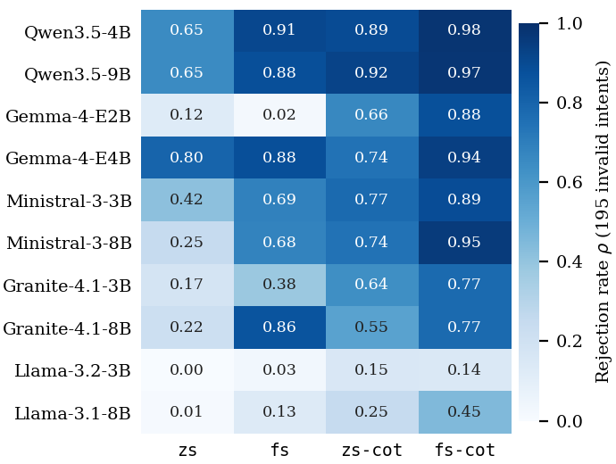

# RQ2: Intent validation

**Question.** Can a lightweight model refuse to configure an intent that must not be provisioned?

**Setup.** The 195 invalid intents of the dataset: ambiguous (65), conflicting (49), malformed (35) and unsupported (46). The prompts of the four setups contain a short rejection instruction; the `fs`/`fs-cot` prompts also show one invalid example. A model **rejects** an intent when its answer is an empty SLO set. An unparseable answer also counts as a rejection (it configures nothing). The rejection rate rho is the share of the 195 invalid intents rejected ("paper-style" rate). Greedy decoding, one run per configuration, native thinking off.

| Name in the code and result files | Name in the paper |
|---|---|
| `zs3` | `zs` |
| `fs3` | `fs` |
| `zs3 CoT` | `zs-cot` |
| `fs3 CoT` | `fs-cot` |

## Figure 3: rejection rate rho on the 195 invalid intents



Darker cells reject more. Data: `results/I-01_rejection_rate_per_category.csv` (also split by category); the counts of rejected intents are in `results/I-02_counts_rejected.csv`.

Overall rejection rate rho:

| Model | zs | fs | zs-cot | fs-cot |
|---|---:|---:|---:|---:|
| Qwen3.5-4B | 0.651 | 0.908 | 0.892 | 0.979 |
| Qwen3.5-9B | 0.651 | 0.882 | 0.923 | 0.974 |
| Gemma-4-E2B | 0.123 | 0.021 | 0.662 | 0.877 |
| Gemma-4-E4B | 0.800 | 0.882 | 0.744 | 0.938 |
| Ministral-3-3B | 0.415 | 0.687 | 0.774 | 0.887 |
| Ministral-3-8B | 0.246 | 0.677 | 0.744 | 0.954 |
| Granite-4.1-3B | 0.174 | 0.379 | 0.636 | 0.774 |
| Granite-4.1-8B | 0.215 | 0.862 | 0.554 | 0.774 |
| Llama-3.2-3B | 0.000 | 0.031 | 0.149 | 0.144 |
| Llama-3.1-8B | 0.010 | 0.128 | 0.246 | 0.446 |

## False rejections: valid intents that were rejected (of 521)

| Model | zs | fs | zs-cot | fs-cot |
|---|---:|---:|---:|---:|
| Qwen3.5-4B | 0 | 0 | 3 | 3 |
| Qwen3.5-9B | 0 | 0 | 0 | 0 |
| Gemma-4-E2B | 0 | 0 | 9 | 18 |
| Gemma-4-E4B | 0 | 0 | 2 | 2 |
| Ministral-3-3B | 0 | 0 | 15 | 11 |
| Ministral-3-8B | 0 | 0 | 0 | 0 |
| Granite-4.1-3B | 0 | 0 | 17 | 36 |
| Granite-4.1-8B | 0 | 0 | 3 | 10 |
| Llama-3.2-3B | 0 | 0 | 3 | 1 |
| Llama-3.1-8B | 0 | 0 | 2 | 8 |

Source: `results/I-06_trade_off.csv` (also holds the rejection rates and the valid-intent F1 of each configuration).

## Key findings (as stated in the paper)
- With `fs-cot`, the four strongest models reject almost all invalid intents: Qwen3.5-4B 191, Qwen3.5-9B 190, Ministral-3-8B 186 and Gemma-4-E4B 183 of the 195.
- Zero-shot (`zs`) instructions are not enough: rho ranges from 0.00 (Llama-3.2-3B) to 0.80 (Gemma-4-E4B), and only three models exceed 0.6. Examples and reasoning together (`fs-cot` against `zs`) raise rho for all ten models, by 0.14 to 0.75 (`results/I-03_overall_rejection_and_differences.csv`).
- Among the 49 conflicting intents, contradictory bounds (12 intents) and requests for both the highest and the lowest value of one metric (15) are all rejected by Qwen3.5 and Ministral-3-8B with `fs-cot`. Intents that require the edge and the cloud at once (12) are rejected by no model with `zs` and by at most 10 of 12 with any setup (Ministral-3-8B, `fs-cot`). The kinds come from a keyword rule and are approximate (`results/I-05_conflicting_rejected_per_kind.csv`).
- Over all configurations, 3,351 of the 7,800 answers to invalid intents contain SLOs. The most common content is a single placement (22 to 50% of them, depending on the category), which keeps the readable part of the request and silently drops the rest; 363 answers to conflicting intents contain both halves of the contradiction (`results/I-09_*.csv`). The 363 does not count the 10 conflicting intents that combine two kinds of conflict; the content classes come from rules and are approximate.
- Without reasoning, no model rejects any of the 521 valid intents. With reasoning, at most 6.9% are rejected (Granite-4.1-3B, `fs-cot`, 36 of 521); Qwen3.5-9B and Ministral-3-8B reject none.

## Reproduce
**Tier A (no GPU, no model; works now).** From the repository root:
```bash
pip install -r requirements-analysis.txt
python rq2_validation/make_figure.py        # rewrites figures/fig3_opt_i_heatmap.*
# then open rq2_validation/rq2.ipynb in Jupyter and run all cells
```
The rebuilt figure shows the same values as the paper's; the PNG may differ in a few pixels because font rendering depends on the FreeType build of the plotting library. The notebook `rq2.ipynb` loads the released CSVs and checks each number of the paper's RQ2 text against the data.

**Tier B (re-score from the predictions; needs the camera-ready archive).** `src/invalid_analysis.py` builds the `I-*` CSVs from the stored model outputs (`outputs/runs/`), using the scorer `src/reject.py`. These outputs are not in this repository yet; `tests/test_invalid_analysis.py` is skipped until they are present.

**Tier C (regenerate with the models).** See the top-level README; needs GPUs and is not bit-for-bit reproducible.

## Citations
- Intent Engine: Islam, K., Calheiros, R. N. *Intent Engine: Natural-language Intent Translation for Intent-Driven Orchestration in the Compute Continuum*. Journal of Systems Architecture 179 (2026) 103938. doi:10.1016/j.sysarc.2026.103938.
- Dataset: Islam, K., Calheiros, R. N. *Natural-Language Intent Translation for Intent-Driven Orchestration in the Compute Continuum Dataset*, version 2, Zenodo. doi:10.5281/zenodo.20810799 (not redistributed here).
- This paper: to be added.
