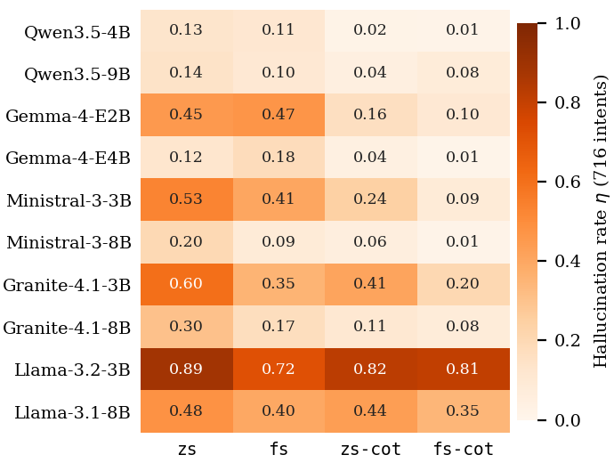

# RQ3: Hallucination

**Question.** How often does a lightweight model write an SLO that its inputs do not support, and how do model, size and prompting setup change this?

**Definition in one paragraph.** An SLO is *hallucinated* if it asserts a requirement or a value that the intent text, the numbers in the intent and the cluster snapshot do not support, for example a placement on a layer the operator never named, or a value that is not the requested metric's value in the snapshot. Not every deviation from the ground truth is a hallucination: a value off in its last digit, `<` for `<=` or an empty value is a *mistake*, because the model asserts nothing that the inputs contradict. The hallucination rate eta is the share of parseable responses with at least one hallucinated SLO. The complete rules are in [`RULEBOOK.md`](RULEBOOK.md).

| Name in the code and result files | Name in the paper |
|---|---|
| `zs3` | `zs` |
| `fs3` | `fs` |
| `zs3 CoT` | `zs-cot` |
| `fs3 CoT` | `fs-cot` |

## Figure 4: hallucination rate eta over all 716 intents



Lighter cells are more trustworthy. Data: `results/A-01_per_condition.csv` (also split into valid and invalid intents).

Hallucination rate eta (share of parseable responses with at least one hallucinated SLO, 716 intents):

| Model | zs | fs | zs-cot | fs-cot |
|---|---:|---:|---:|---:|
| Qwen3.5-4B | 0.131 | 0.110 | 0.018 | 0.013 |
| Qwen3.5-9B | 0.144 | 0.105 | 0.045 | 0.077 |
| Gemma-4-E2B | 0.450 | 0.467 | 0.163 | 0.103 |
| Gemma-4-E4B | 0.122 | 0.177 | 0.041 | 0.008 |
| Ministral-3-3B | 0.529 | 0.406 | 0.245 | 0.085 |
| Ministral-3-8B | 0.198 | 0.085 | 0.058 | 0.014 |
| Granite-4.1-3B | 0.602 | 0.355 | 0.414 | 0.204 |
| Granite-4.1-8B | 0.304 | 0.170 | 0.109 | 0.078 |
| Llama-3.2-3B | 0.885 | 0.716 | 0.823 | 0.808 |
| Llama-3.1-8B | 0.477 | 0.398 | 0.437 | 0.347 |

## Table III: two examples of hallucinated SLOs

| Intent (abridged) | Ground-truth SLOs | Model (setup): hallucinated SLO | Why it is a hallucination |
|---|---|---|---|
| "Deploy svc ... at least 50 GB of storage capacity and pick the node with the lowest current memory utilization" (valid) | storage cap. >= 50 GiB; memory util. <= [lowest] 34.27 % | Qwen3.5-9B (`zs`): memory util. <= [lowest] **18.0** % | 18.0 is the *storage* utilization of the correct node: right node, wrong metric |
| "I would like to place svc and keep CPU utilization below 40 %" (valid) | CPU util. <= 40 % | Qwen3.5-9B (`fs-cot`): placement = **edge** | a placement layer the intent does not name |

The LaTeX table is `results/tab3_rq3.tex`. The intents come from the dataset cited below; GB values are shown in GiB (1 GiB = 2^30 bytes) because the dataset reads "GB" in the intents as 2^30 bytes.

## Key findings (as stated in the paper)
- Reasoning lowers eta for all ten models with zero-shot prompts and for nine of ten with few-shot prompts; examples alone lower it for eight (`results/A-04_setup_effects_pooled.csv`).
- The best configurations hallucinate in about one response in a hundred: Gemma-4-E4B (0.008) and Qwen3.5-4B (0.013), both with `fs-cot`.
- Pooled over its two models and four setups, eta per family ranges from 0.080 (Qwen3.5) through 0.191 (Gemma 4), 0.203 (Ministral 3) and 0.279 (Granite 4.1) to 0.610 (Llama 3) (`results/A-01_per_family.csv`).
- The larger model hallucinates less in four of the five families; Qwen3.5 is the exception, where the 9B model is slightly worse than the 4B model (0.093 against 0.068) (`results/A-04_size_per_family.csv`).
- Over all 40 configurations, 27.1% of the parseable responses contain at least one hallucinated SLO (valid 26.9%, invalid 27.6%).
- On valid intents, eight of the ten models more often write an unsupported value (from the wrong node, metric or unit conversion) than an unsupported requirement. On invalid intents, they fill in what the text leaves open, mostly a placement layer or a metric (`results/A-05_kind.csv`).

## How the labels were made
The 28,640 responses (10 models x 4 setups x 716 intents) contain 14,896 distinct (intent, SLO) pairs with a fault: 9,468 for valid intents and 5,428 for invalid intents. (The paper's Metrics section gives 15,181; that count also includes 285 placeholder rows for unparseable responses, which contain no SLO.) For valid intents the labels come from deterministic rules against the intent and the snapshot. For invalid intents, whose ground truth is "reject", an LLM (Claude Sonnet 5.5, not among the evaluated models) read each of the 35 distinct invalid intent texts under the rulebook and wrote a per-intent specification; the specifications are applied automatically to every returned SLO (`scripts/judge_invalid_v2.py`). A stratified sample of the labels was checked by one human annotator; the sample, the protocol and the responses will be released with the camera-ready archive. Some ground-truth values of the dataset do not follow the dataset's own rule that an extremum is taken over the layer named in the intent; a value that the intent and the snapshot support is not counted as a hallucination.

## Reproduce
**Tier A (no GPU, no model; works now).** From the repository root:
```bash
pip install -r requirements-analysis.txt
python rq3_hallucination/make_figure.py      # rewrites figures/fig4_opt_i_heatmap.*
# then open rq3_hallucination/rq3.ipynb in Jupyter and run all cells
```
The rebuilt figure shows the same values as the paper's; the PNG may differ in a few pixels because font rendering depends on the FreeType build of the plotting library. The notebook `rq3.ipynb` loads the released CSVs and checks each number of the paper's RQ3 text against the data.

**Tier B (re-label from the predictions; needs the camera-ready archive).**
```bash
python scripts/halluc_workload_v2.py                 # labels of the valid intents (rules)
python scripts/judge_invalid_v2.py                   # labels of the invalid intents (specifications)
python scripts/merge_judged_labels.py                # puts them into the constraint file (policy_v2j_constraints.csv)
python scripts/halluc19_responses.py --tag v2j       # one row per response, then src/halluc19.py makes the A-* tables
```
These steps read the model outputs (`outputs/runs/`) and write the per-constraint label files (19,765 rows), none of which are in this repository yet. `judge_invalid_v2.py`, `merge_judged_labels.py` and `halluc19_responses.py` refuse to overwrite existing results; `halluc_workload_v2.py` rewrites `policy_v2_constraints.csv`. `merge_judged_labels.py` reproduces the label file of the paper byte for byte from the other two. `tests/test_halluc*.py` pass without the outputs.

**Tier C (regenerate with the models).** See the top-level README; needs GPUs and is not bit-for-bit reproducible.

## Citations
- Intent Engine: Islam, K., Calheiros, R. N. *Intent Engine: Natural-language Intent Translation for Intent-Driven Orchestration in the Compute Continuum*. Journal of Systems Architecture 179 (2026) 103938. doi:10.1016/j.sysarc.2026.103938.
- Dataset (intent texts and ground truth, including the 35 invalid intent texts quoted in `scripts/judge_invalid_v2.py`): Islam, K., Calheiros, R. N. *Natural-Language Intent Translation for Intent-Driven Orchestration in the Compute Continuum Dataset*, version 2, Zenodo. doi:10.5281/zenodo.20810799 (CC BY 4.0; not redistributed in full here).
- This paper: to be added.
