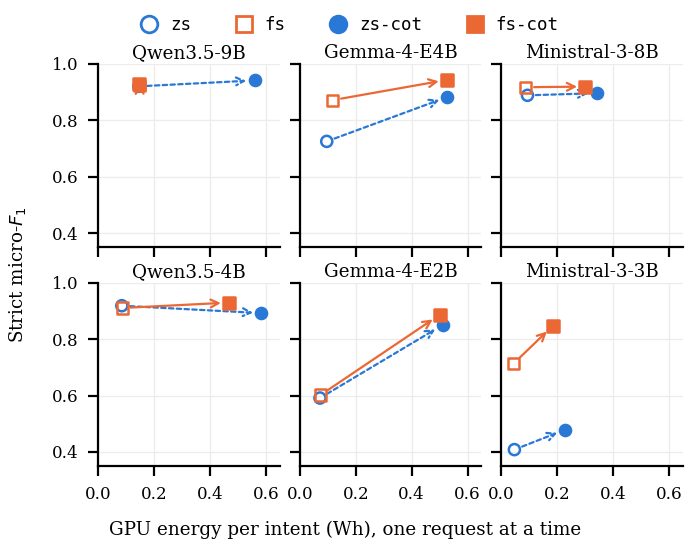

# RQ4: Energy and emissions

**Question.** What does it cost, in energy and carbon, to translate an intent with a lightweight model, and how do reasoning, load and model choice change it?

**Setup.** Six models of the three most accurate families of RQ1 (Qwen3.5, Gemma 4, Ministral 3), four setups each, 24 configurations. Each model runs with vLLM on its own H100 NVL GPU with no other process on it. GPU energy is read from the NVML energy counter at three load levels: one request at a time, and 16 and 64 concurrent requests. 11,808 requests were measured. The energy of the 521 valid intents is estimated from a per-model linear fit on the generated tokens (cross-validated R2 of at least 0.996). **All values are GPU energy only**, so they are lower bounds of the energy of a full deployment (no host CPU or memory, networking, cooling, embodied carbon or water). Every number is derived step by step in [`DERIVATIONS.md`](DERIVATIONS.md).

| Name in the code and result files | Name in the paper |
|---|---|
| `zs3` | `zs` |
| `fs3` | `fs` |
| `zs3_cot` | `zs-cot` |
| `fs3_cot` | `fs-cot` |

## Figure 6: energy per intent against strict F1



One panel per model; the four points are the four setups, arrows go from the setup without reasoning to the setup with reasoning. Data: `results/E-04_energy_and_accuracy_per_cell.csv`.

Energy per intent in Wh, one request at a time (mean over the 521 valid intents):

| Model | zs | fs | zs-cot | fs-cot |
|---|---:|---:|---:|---:|
| Qwen3.5-4B | 0.085 | 0.086 | 0.584 | 0.469 |
| Qwen3.5-9B | 0.145 | 0.148 | 0.560 | 0.148 |
| Gemma-4-E2B | 0.072 | 0.074 | 0.511 | 0.500 |
| Gemma-4-E4B | 0.096 | 0.118 | 0.527 | 0.527 |
| Ministral-3-3B | 0.046 | 0.044 | 0.227 | 0.184 |
| Ministral-3-8B | 0.093 | 0.087 | 0.340 | 0.300 |

## Key findings (as stated in the paper)
- Served one request at a time, an intent costs 0.044 to 0.148 Wh without reasoning and 0.18 to 0.58 Wh with it. Qwen3.5-9B `fs-cot` is left out of the second range (0.148 Wh): it usually answers directly without writing out its reasoning, so its cost equals that of `fs`.
- Reasoning multiplies the energy per intent by 3.5 to 7.1. It buys 26 to 28 F1 points for Gemma-4-E2B, 13 points for Ministral-3-3B (`fs`), and at most about 2 points (2.1) for Qwen3.5 and Ministral-3-8B.
- Serving 64 requests at once instead of one lowers the energy per intent by a factor of 3.2 to 20.2 (median 6.1), to 33 to 186 J (0.009 to 0.052 Wh). The price is latency: the 95th-percentile response time rises from 0.8 to 3.2 s to 10 to 27.5 s without reasoning, and from 2.1 to 20.4 s to 24.5 to 71.2 s with reasoning.
- At realistic rates the idle power of the GPU dominates. For a dedicated GPU (idle draw 101 to 108 W) loaded to at most 50% of its throughput under a 30 s latency bound, idle draw is 81 to 97% (median 93%) of the 2.5 to 3.2 kWh it uses per day at 10,000 intents. This holds for 23 of the 24 configurations; Qwen3.5-4B `zs-cot` is the exception (it needs 2 GPUs, 9.36 kWh per day, 55% idle).
- With a PUE of 1.56 (Uptime Institute survey 2024) and the 2025 world grid intensity of 0.458 kg CO2e per kWh (Ember), this corresponds to 0.18 to 0.67 g CO2e per intent over all 24 configurations (0.18 to 0.23 g for the 23 single-GPU ones). The location of the data center changes it about 16-fold, from 0.016 to 0.061 g in France to 0.26 to 0.98 g in India.

## Files
| Path | Purpose |
|---|---|
| `results/` | The 15 result tables E-01 to E-05 (energy, load, cost model, energy against accuracy, daily projection and CO2e) and the grid factors. |
| `DERIVATIONS.md` | How every number of the paper is computed, with the full tables for all 24 configurations. |
| `make_figure.py`, `figures/` | Rebuild Fig. 6 from `E-04`. |
| `rq4.ipynb` | Checks each number of the paper's RQ4 text against the result tables. |
| `build_tables_from_raw_data.py` | Rebuilds the 15 tables from the raw measurements (**needs the raw data**, released with the camera-ready archive). |
| `../scripts/energy_probe2.py`, `../scripts/run_energy_full.sh` | The measurement tool and its launcher (GPU needed). |
| `../docs/models.md`, `../docs/implementation.md` | The models and the implementation and measurement details. |

## Reproduce
**Tier A (no GPU, no raw data; works now).** From the repository root:
```bash
pip install -r requirements-analysis.txt
python rq4_energy/make_figure.py          # rewrites figures/fig6_opt_a_panels.*
# then open rq4_energy/rq4.ipynb in Jupyter and run all cells
```
The rebuilt figure shows the same values as the paper's; the PNG may differ in a few pixels because font rendering depends on the FreeType build of the plotting library.

**Tier B (rebuild the tables from the raw measurements; needs the camera-ready archive).**
```bash
python rq4_energy/build_tables_from_raw_data.py --raw outputs/energy/run_20261025 --out outputs/energyAnalysis_rebuilt
```
It also needs the accuracy and invalid-intent runs (`outputs/runs/`) for the F1 and exact match of `E-04`. On the authors' data it reproduces all 15 tables byte for byte. `tests/test_energy*.py` pass without the raw data.

**Tier C (re-measure; needs an H100-class GPU).** `scripts/run_energy_full.sh <run_id> <gpu> <port> <model> ...` starts one server per model and runs the measurement (about 2 hours per GPU for three models). Results depend on the GPU, driver and idle power of the machine.

## Citations
- NVML energy counter: Chung, J.-W. et al. *The ML.ENERGY Benchmark: Toward Automated Inference Energy Measurement and Optimization*. arXiv:2505.06371 (2025).
- Emissions: Patterson, D. et al. *Carbon Emissions and Large Neural Network Training*. arXiv:2104.10350 (2021).
- PUE: Uptime Institute. *Uptime Institute Global Data Center Survey 2024*, Keynote Report 146M (2024).
- Grid intensity: Ember. *Yearly Electricity Data* (carbon intensity, 2025 values), https://ember-energy.org/data/yearly-electricity-data/ (accessed 2026-10-26).
- Intent Engine and dataset: see the top-level citations (Islam, K., Calheiros, R. N., doi:10.1016/j.sysarc.2026.103938 and doi:10.5281/zenodo.20810799).
- This paper: to be added.
