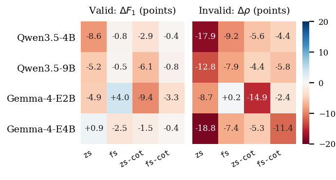
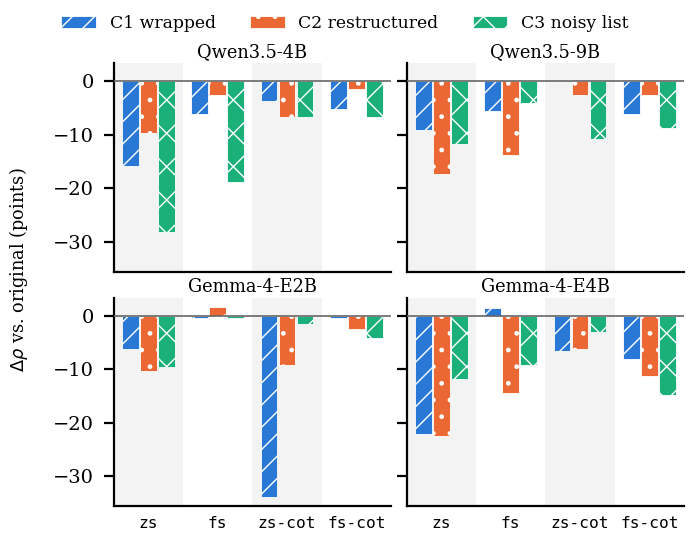

# RQ5: Robustness to operator phrasing

**Question.** Does a lightweight translator still work when the operator writes the intent differently from the dataset's short one-line requests, and does intent validation survive rephrasing?

**Setup.** Each of the 716 intents was rewritten in three compound variants (**C1** wrapped request, **C2** restructured request, **C3** noisy list; defined in [`../data/robust/README.md`](../data/robust/README.md)), giving 2,148 variants. The originals and their variants were fed with all four prompts to the two most accurate families of RQ1, Qwen3.5 (4B, 9B) and Gemma 4 (E2B, E4B): 16 configurations and 45,824 inputs. For each configuration, the strict F1 on the valid variants and the rejection rate rho on the invalid variants are compared with the same metrics on the original intents, re-run in the same run. Because outputs vary slightly with the batch composition, only patterns that recur across configurations are interpreted, and results are never averaged across models.

| Name in the code and result files | Name in the paper |
|---|---|
| `zs3` | `zs` |
| `fs3` | `fs` |
| `zs3 CoT` | `zs-cot` |
| `fs3 CoT` | `fs-cot` |

**Data released here.** Only a sample: [`../data/robust/robust_benchmark_sample.json`](../data/robust/robust_benchmark_sample.json) (and `.csv`) holds 10 intents with their C1, C2 and C3 variants (30 rows). **The full benchmark of 2,148 variants is available on request: sabbir.ahmed@queensu.ca.** The result tables in this folder contain no intent texts.

## Figure 7: change per model and setup



Change in points between the variants C1 to C3 (pooled) and the original intents, for strict F1 on valid intents (left) and rejection rate on invalid intents (right). Data: `results/overview_all_716_by_model_setup.csv`.

Strict F1 on valid intents, original -> variants C1 to C3 pooled (change in points):

| Model | zs | fs | zs-cot | fs-cot |
|---|---|---|---|---|
| Qwen3.5-4B | 0.920 -> 0.833 (-8.6) | 0.912 -> 0.905 (-0.8) | 0.885 -> 0.856 (-2.9) | 0.928 -> 0.924 (-0.4) |
| Qwen3.5-9B | 0.920 -> 0.868 (-5.2) | 0.923 -> 0.919 (-0.5) | 0.944 -> 0.883 (-6.1) | 0.930 -> 0.922 (-0.8) |
| Gemma-4-E2B | 0.588 -> 0.539 (-4.9) | 0.606 -> 0.646 (+4.0) | 0.829 -> 0.735 (-9.4) | 0.885 -> 0.852 (-3.3) |
| Gemma-4-E4B | 0.729 -> 0.738 (+0.9) | 0.870 -> 0.844 (-2.5) | 0.878 -> 0.863 (-1.5) | 0.948 -> 0.944 (-0.4) |

Rejection rate on invalid intents, original -> variants (change in points):

| Model | zs | fs | zs-cot | fs-cot |
|---|---|---|---|---|
| Qwen3.5-4B | 0.651 -> 0.472 (-17.9) | 0.897 -> 0.805 (-9.2) | 0.918 -> 0.862 (-5.6) | 0.959 -> 0.914 (-4.4) |
| Qwen3.5-9B | 0.646 -> 0.518 (-12.8) | 0.892 -> 0.814 (-7.9) | 0.923 -> 0.879 (-4.4) | 0.974 -> 0.916 (-5.8) |
| Gemma-4-E2B | 0.118 -> 0.031 (-8.7) | 0.015 -> 0.017 (+0.2) | 0.636 -> 0.487 (-14.9) | 0.872 -> 0.848 (-2.4) |
| Gemma-4-E4B | 0.800 -> 0.612 (-18.8) | 0.882 -> 0.808 (-7.4) | 0.754 -> 0.701 (-5.3) | 0.949 -> 0.834 (-11.4) |

## Figure 8: change in rejection per variant



Change in rejection rate of the invalid intents for each phrasing variant. Data: `results/H-08_per_model_and_setup_all_intents.csv` (per configuration and variant; it also holds the share of valid variants rejected and the F1 per variant, and rows with the mean of the four models).

Rejection rate per invalid category, pooled over the 16 configurations (`results/rq5_rejection_by_category_716.csv`):

| Invalid category | original | C1 wrapped | C2 restructured | C3 noisy list |
|---|---:|---:|---:|---:|
| ambiguous | 0.741 | 0.669 | 0.735 | 0.742 |
| conflicting | 0.709 | 0.723 | 0.533 | 0.494 |
| malformed | 0.679 | 0.466 | 0.621 | 0.536 |
| unsupported | 0.830 | 0.739 | 0.722 | 0.768 |

`results/H-05_pooled_headline.csv` gives the exact match, F1 and rejection pooled over all configurations for the original and each variant.

## Key findings (as stated in the paper)
- Rephrasing lowers the rejection rate in 15 of the 16 configurations, by up to 18.8 points (Gemma-4-E4B, `zs`). F1 drops in 14, by up to 9.4 points (Gemma-4-E2B, `zs-cot`).
- Zero-shot is the most fragile setup, losing 8.7 to 18.8 points of rejection. Few-shot examples reduce the losses: with `fs` or `fs-cot`, Qwen3.5 and Gemma-4-E4B lose 4.4 to 11.4 points of rejection and at most 2.5 points of F1.
- The only configuration that gains on both metrics, Gemma-4-E2B with `fs` (F1 +4.0, rho +0.2), does so from a weak baseline (F1 0.6, rho 0.015), not through robustness.
- Rejection falls in 14, 15 and 16 configurations under C1, C2 and C3. The largest single drop is Gemma-4-E2B with `zs-cot` under C1 (rejection 0.64 -> 0.30).
- Restructuring (C2) and the noisy list (C3) hide contradictions, so the rejection of conflicting intents falls. Wrapping (C1) makes broken fragments read like normal requests, lowering the rejection of malformed intents.

## Files
| Path | Purpose |
|---|---|
| `results/` | The four result tables behind the figures and findings (no texts). |
| `make_figures.py`, `figures/` | Rebuild Fig. 7 and Fig. 8 from the result tables. |
| `rq5.ipynb` | Checks each number of the paper's RQ5 text against the result tables and checks the released sample. |
| `../data/robust/` | The 30-row sample and its README (fields, variants, licence, contact for the full set). |

## Reproduce
**Tier A (no GPU, no model; works now).** From the repository root:
```bash
pip install -r requirements-analysis.txt
python rq5_robustness/make_figures.py      # rewrites figures/fig7_*
# then open rq5_robustness/rq5.ipynb in Jupyter and run all cells
```
The rebuilt figures show the same values as the paper's; the PNG files may differ in a few pixels because font rendering depends on the FreeType build of the plotting library.

**Tier B (rebuild the tables from the predictions).** This needs the full benchmark (on request) and the model outputs of the camera-ready archive. The table-building code for this research question will be released together with them. The model outputs are made with the same runner and prompts as RQ1 (`scripts/run_zs_cot.py`).

## Citations
- Dataset (original intents and ground truth): Islam, K., Calheiros, R. N. *Natural-Language Intent Translation for Intent-Driven Orchestration in the Compute Continuum Dataset*, version 2, Zenodo. doi:10.5281/zenodo.20810799 (CC BY 4.0 and Apache 2.0).
- Intent Engine: Islam, K., Calheiros, R. N. *Intent Engine: Natural-language Intent Translation for Intent-Driven Orchestration in the Compute Continuum*. Journal of Systems Architecture 179 (2026) 103938. doi:10.1016/j.sysarc.2026.103938.
- This paper: to be added.
